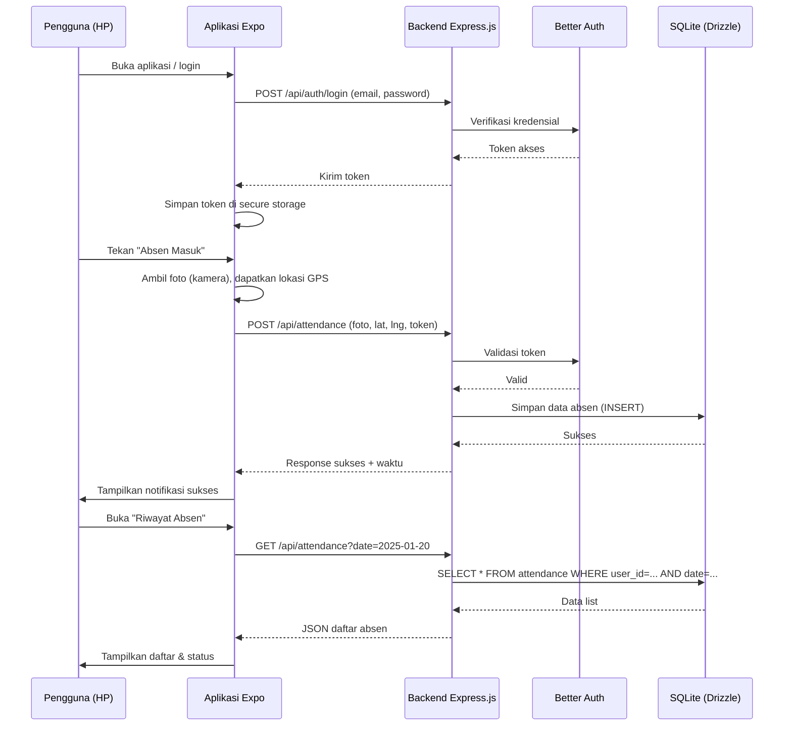
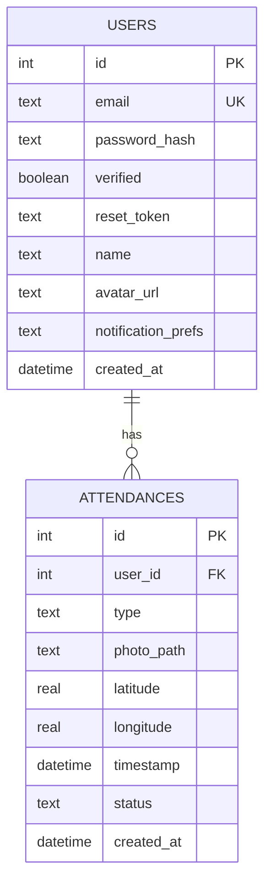

# PRD — Project Requirements Document

## 1. Overview
Aplikasi ini dirancang untuk mencatat kehadiran pribadi secara digital melalui perangkat seluler. Masalah utama yang diatasi adalah pencatatan manual yang mudah hilang atau sulit dilacak, serta tidak adanya bukti visual dan lokasi yang terintegrasi. Aplikasi memungkinkan pengguna melakukan absen masuk dan keluar dengan cepat menggunakan foto selfie dan rekaman GPS, sekaligus menyimpan riwayat absensi yang rapi dan mudah ditinjau. Tujuan utamanya adalah menyediakan pengalaman absensi yang lebih cepat, transparan, dan dapat dipercaya.

## 2. Requirements
- Aplikasi **mobile** (iOS & Android) menggunakan Expo + React Native.
- **Backend server** berjalan di atas Express.js untuk menangani API.
- **Otentikasi** menggunakan Better Auth berbasis email/kata sandi (daftar, login, lupa password, verifikasi email).
- Pengguna dapat **mengambil foto** langsung dari kamera perangkat sebagai bukti kehadiran.
- Aplikasi harus mampu **mendeteksi lokasi GPS** (latitude & longitude) perangkat saat absen.
- Data absen (foto, lokasi, waktu) disimpan di **database SQLite** melalui Drizzle ORM.
- Riwayat absen harus bisa difilter berdasarkan **tanggal** dan menampilkan status tepat/lambat.
- Pengguna dapat melihat dan mengelola **profil pribadi** (nama, foto profil, pengaturan notifikasi, logout).

## 3. Core Features

### Fase 1 – Absensi Harian & Riwayat
1. **Riwayat Absen** — Melihat catatan kehadiran harian dan riwayat absensi lengkap.
   - Daftar absen masuk/keluar hari ini secara kronologis.
   - Filter untuk memilih tanggal tertentu.
   - Detail absen menampilkan foto, lokasi, waktu lengkap, dan status kehadiran (tepat waktu/terlambat).
2. **Absen Sekarang** — Melakukan absen masuk/keluar dengan bukti foto dan lokasi.
   - Ambil foto selfie secara langsung dari kamera.
   - Rekam koordinat GPS secara otomatis.
   - Tampilkan ringkasan (foto + lokasi) untuk konfirmasi sebelum data dikirim.
   - Notifikasi bahwa absen berhasil tercatat, menampilkan waktu masuk/keluar.

### Fase 2 – Keamanan Akun
3. **Autentikasi** — Mendaftar dan masuk ke akun pribadi.
   - Daftar akun baru dengan email & kata sandi.
   - Login menggunakan kredensial terdaftar.
   - Lupa password: reset melalui email pemulihan.
   - Verifikasi email dengan tautan/kode untuk mengaktifkan akun.

### Fase 3 – Manajemen Diri
4. **Profil Saya** — Melihat dan mengelola informasi pribadi.
   - Lihat data diri (nama, email, foto profil).
   - Ubah foto profil (dari galeri/kamera).
   - Pengaturan akun (notifikasi, ganti kata sandi).
   - Logout untuk keluar dari sesi.

## 4. User Flow
1. **Pertama kali membuka aplikasi:**  
   Pengguna diarahkan ke layar login/daftar (Fase 2). Jika belum punya akun, daftar dengan email & password → verifikasi email → masuk ke halaman utama.

2. **Setelah login (halaman utama):**  
   Terdapat dua menu utama: **“Absen Sekarang”** dan **“Riwayat Absen”** (Fase 1). Profil dapat diakses melalui ikon avatar di kanan atas (Fase 3).

3. **Melakukan absen:**  
   - Tekan tombol “Absen Masuk” (atau “Absen Keluar” sesuai konteks).  
   - Aplikasi membuka kamera → ambil selfie → deteksi lokasi otomatis.  
   - Layar konfirmasi menampilkan foto dan peta singkat lokasi.  
   - Tekan “Kirim” → data terkirim ke backend → notifikasi sukses muncul.  
   - Kembali ke halaman utama, tombol berganti status (misal “Absen Keluar”).

4. **Melihat riwayat:**  
   - Pilih menu “Riwayat Absen” → daftar absen hari ini muncul.  
   - Bisa memilih tanggal lain melalui filter kalender.  
   - Ketuk salah satu entri untuk melihat detail (foto, lokasi, waktu, status terlambat).

5. **Profil & logout:**  
   - Buka profil → lihat/edit foto/nama → atur notifikasi → logout → kembali ke layar login.

## 5. Architecture
Sistem menggunakan arsitektur client-server sederhana. Frontend (Expo) mengirim permintaan HTTP ke server Express. Setiap request yang memerlukan otentikasi akan diverifikasi oleh Better Auth. Data disimpan di SQLite melalui Drizzle ORM.

## 6. Database Schema
Database menggunakan SQLite dengan tabel/relasi sebagai berikut. Hubungan antar tabel divisualkan dalam diagram ER di bawah.

- **users**: menyimpan data akun pengguna.
  - `id` (INTEGER, primary key)
  - `email` (TEXT, unique, not null)
  - `password_hash` (TEXT, not null)
  - `verified` (BOOLEAN, default false)
  - `reset_token` (TEXT, nullable)
  - `name` (TEXT)
  - `avatar_url` (TEXT)
  - `notification_prefs` (TEXT – JSON string untuk fleksibilitas)
  - `created_at` (DATETIME)

- **attendances**: satu pengguna bisa memiliki banyak catatan absen.
  - `id` (INTEGER, primary key)
  - `user_id` (INTEGER, foreign key ke users.id, not null)
  - `type` (TEXT, ‘in’ atau ‘out’, not null)
  - `photo_path` (TEXT, path/link ke foto, not null)
  - `latitude` (REAL)
  - `longitude` (REAL)
  - `timestamp` (DATETIME, tidak boleh null – sebagai waktu absen sebenarnya)
  - `status` (TEXT, ‘on_time’ atau ‘late’)
  - `created_at` (DATETIME default now)

## 7. Tech Stack
- **Frontend**: Expo (React Native) – memungkinkan build untuk iOS & Android dengan akses native ke kamera (expo-camera) dan lokasi (expo-location).
- **Backend**: Express.js (Node.js) – API RESTful untuk melayani autentikasi dan data absensi.
- **Database**: SQLite – basis data ringan yang mudah dikelola, cocok untuk skala kecil-menengah.
- **ORM**: Drizzle ORM – mempermudah query database dengan type-safety.
- **Autentikasi**: Better Auth – menangani login, registrasi, verifikasi email, dan reset password secara built-in.
- **Deployment**: Disarankan menggunakan VPS (misal DigitalOcean, Linode) atau platform seperti Fly.io untuk backend, serta layanan managed seperti EAS Build untuk distribusi aplikasi Expo.